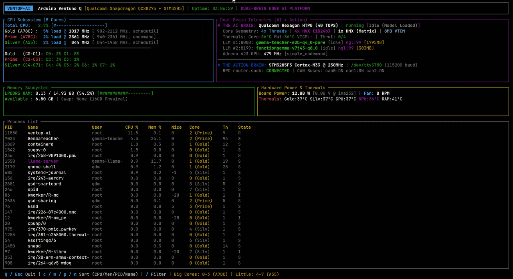
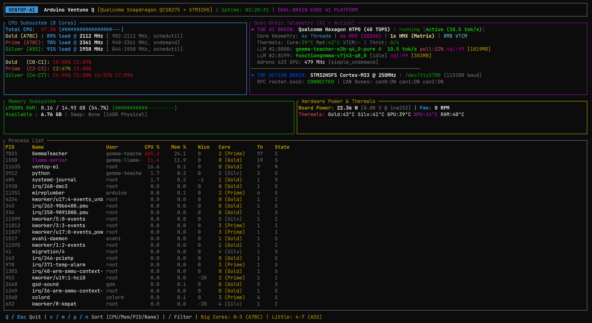

# ⚡ ventop-ai

### Dual-Brain Edge AI & Action Telemetry Monitor for Arduino Ventuno Q
*Qualcomm Snapdragon QCS8275 (Hexagon v75 40 TOPS HTP) + STMicroelectronics STM32H5F5 Cortex-M33*

[](https://www.arduino.cc/)
[]()
[]()
[](LICENSE)
[]()
[]()

Low-overhead system monitor and Hexagon NPU telemetry daemon engineered specifically for the **Arduino Ventuno Q** single-board computer (Qualcomm Snapdragon QCS8275 SoC + STM32H5F5 MCU).

Provides an interactive terminal dashboard (TUI) for system operators and structured JSON/NDJSON streams with phase markers, thread placement profiling, and statistical summaries for automated benchmarking pipelines and AI agents optimizing on-device inference.



---

## 1. Quick Start & CLI Reference

`ventop-ai` requires zero configuration and adapts automatically to available hardware:

> [!TIP]
> **Privileged vs. Unprivileged Execution**:
> `ventop-ai` runs unprivileged for CPU, GPU devfreq, power, fans, thermals, CAN, and serial monitoring. 
> To enable exact kernel **DMA-BUF VRAM accounting** (`/sys/kernel/debug/...`) and inspect processes owned by other users, run with `sudo` (e.g. `sudo ventop-ai`), or see [Section 7](#7-permissions--on-target-setup) for non-root configuration.

```bash
# Launch interactive terminal UI (TUI) dashboard (add `sudo` for full kernel DMA-BUF VRAM)
ventop-ai
# or: sudo ventop-ai

# Output a single human-readable snapshot and exit
ventop-ai --oneshot

# Output a single structured JSON telemetry snapshot to stdout and exit
ventop-ai --json | jq .hexagon_npu

# Stream continuous NDJSON snapshots every 200ms
ventop-ai --stream 200

# Calibrate idle power baseline from live sensor at startup
ventop-ai --calibrate-idle

# Track specific processes with thread placement on Big vs Little cores
ventop-ai --stream 500 --proc llama-server,arduino-router

# Profile a timed inference run with phase markers and statistical summary
ventop-ai --stream 200 --duration 60 --mark-file /tmp/event.mark --summary

# Discover comprehensive machine-readable JSON schema and field dictionary
ventop-ai --schema
```

### CLI Command Options

| Flag | Argument | Description |
|---|---|---|
| `-j`, `--json` | *None* | Output a single JSON snapshot to `stdout` and exit |
| `-1`, `--oneshot` | *None* | Output a single plaintext telemetry snapshot to `stdout` and exit |
| `-s`, `--stream` | `[MS]` | Stream continuous NDJSON snapshots at interval in milliseconds (default: `200ms`) |
| `-w`, `--watch` | `[SECS]` | Stream continuous NDJSON snapshots at interval in seconds (default: `1s`) |
| `-d`, `--duration` | `<SECS>` | Run streaming session for specified duration in seconds and exit |
| `--summary` | *None* | Output statistical summary report (min/median/p90/max) upon stream exit |
| `--mark-file` | `<PATH>` | Inject dynamic phase event markers from file into top-level `.marker` field |
| `-p`, `--proc` | `<NAMES>` | Track specific processes and thread-to-core placement (comma-separated) |
| `-t`, `--threads` | *None* | Include thread-level placement decomposition in JSON snapshots |
| `--active-threshold-pct`| `<PCT>` | CPU threshold % for tracked process co-activity (default: `50.0`) |
| `--calibrate-idle` | *None* | Calibrate board idle power baseline at startup from live sensor |
| `--idle-baseline-w` | `<W>` | Override board idle power baseline in Watts (default: `11.3 W`) |
| `--schema` | *None* | Print comprehensive JSON schema and field dictionary and exit |
| `-v`, `--version` | *None* | Print version information and exit |
| `-h`, `--help` | *None* | Print command-line help message and exit |

---

## 2. Architecture: The Dual-Brain Edge Platform

The Arduino Ventuno Q pairs high-throughput Edge AI inference with deterministic hard real-time control:

```
+-----------------------------------------------------------------------------------+
|                            ARDUINO VENTUNO Q                                      |
|                                                                                   |
|  +-------------------------------------+   +-----------------------------------+  |
|  |     "THE AI BRAIN" (Qualcomm)       |   |    "THE ACTION BRAIN" (STMicro)   |  |
|  |   Snapdragon QCS8275 (Monaco-Monza) |   |    STM32H5F5 Cortex-M33 @ 250MHz  |  |
|  |   - 8 Cores: 4x A78C + 4x A55       |   |    - Hard real-time control       |  |
|  |   - Adreno 623 GPU (479 - 877 MHz)  |   |    - Deterministic GPIO, PWM, I2C |  |
|  |   - Hexagon v75 HTP NPU (40 TOPS)   |   |    - 3x CAN-FD buses (can0..can2) |  |
|  |   - 16 GB LPDDR5 | 64 GB eMMC       |   |    - Arduino Core on Zephyr RTOS  |  |
|  |   - Linux 6.8 / Ubuntu 24.04 LTS    |   +-----------------+-----------------+  |
|  +------------------+------------------+                     │                    |
|                     │                                        │                    |
|                     └─────────► Internal USB 2.0 CDC-ACM ◄───┘                    |
|                                 (/dev/ttySTM0, 115200 baud)                       |
|                                 arduino-router (MsgPack RPC)                      |
+-----------------------------------------------------------------------------------+
```

---

## 3. Telemetry Subsystems & Hardware Discovery

`ventop-ai` utilizes dynamic sysfs/procfs discovery without hardcoded device indices or brittle file offsets.

### A. The AI Brain (Qualcomm Snapdragon QCS8275)
- **CPU Subsystem (8 Cores)**:
  - Dynamically discovers cluster topology from `/sys/devices/system/cpu/cpufreq/policy*`:
    - **Gold Cluster (Cores 0–1)**: Cortex-A78C (typical max ~2.11 GHz)
    - **Prime Cluster (Cores 2–3)**: Cortex-A78C (typical max ~2.36 GHz)
    - **Silver Cluster (Cores 4–7)**: Cortex-A55 (typical max ~1.96 GHz)
  - Computes cluster utilization and Big vs Little core allocations. If cpufreq nodes are unreadable, reports `unavailable` rather than fabricating static frequencies.
- **Qualcomm Hexagon Tensor NPU (40 dense TOPS)**:
  - **Remoteproc Lifecycle**: Status of CDSP remoteproc (`running` / `offline`).
  - **FastRPC Client Qualification**: Scans `/proc/*/fd` for handles to `/dev/fastrpc-cdsp*`, filtering out background system daemons (`cdsprpcd`, `adsprpcd`, audio routers).
  - **Inference Activity State**: Evaluates activity (`Active (Token Generation)`, `Active (Prompt Processing)`, `Active (FastRPC RPC)`, `Idle (Model Loaded)`, `Idle`) strictly requiring an active client process or verified inference power delta. High baseline idle power without a client correctly reports `Idle`.
  - **Token Speed (TPS)**: Live prompt and generation speeds from `/slots` with task-latching retention.
  - **Terminal Token Counting**: Latches terminal tokens even when slots idle between polling ticks.
  - **DMA-BUF VRAM Accounting**: Megabytes allocated to CDSP SMMU context banks (`compute-cb@1`..`@12` via `/sys/kernel/debug/dma_buf/bufinfo`), returning `null` when debugfs is unmounted or unprivileged.
  - **GLINK Mailbox Pulse**: Transaction rate of the CDSP mailbox IRQ in `/proc/interrupts`, disambiguating CDSP from audio ADSP lines.
  - **Silicon Thermals**: Discovered from `/sys/class/thermal/thermal_zone*` matching sensor types (`nsp-*`: Core vector, HMX matrix, VTCM).
  - **Thermal Throttling**: Discovered from cooling devices matching `cdsp`, `cdsp_sw`, or `nsp_cooling`.
- **Qualcomm Adreno 623 GPU**:
  - Discovered by scanning `/sys/class/devfreq/*gpu*` or `*kgsl*`. Reports live clock frequency and governor, or `Off`/`Unavailable` when powered down.

### B. The Action Brain (STMicroelectronics STM32H5F5)
- Internal USB CDC-ACM serial link (`/dev/ttySTM0` or `/dev/ttyACM*`) with USB vendor ID verification (`0483` STMicro, `2341` Arduino).
- Unix socket connection status to `arduino-router.service` on `/var/run/arduino-router.sock`.
- Network link state and I/O byte counters for 3x CAN-FD buses (`can0`, `can1`, `can2`).

### C. Hardware Power & Thermals
- **TI INA232 Power Monitor**: Discovered via `/sys/class/hwmon/*/name` (live voltage, current, and board power in Watts).
- **Power Delta Above Idle**: Real-time `power_above_idle_w` calculation against the calibrated baseline.
- **Microchip EMC2305 Fan Controller**: Discovered via `/sys/class/hwmon/*/name` (live PWM tachometer RPM).
- **Consolidated Thermals**: Condenses 48 hardware TSENS channels into 6 key zones (`CPU Gold`, `CPU Silver`, `GPU`, `Hexagon NPU`, `LPDDR5 RAM`, `Board / PMIC`).

---

## 4. Interactive Terminal UI (TUI)

Launch `ventop-ai` without arguments in any terminal supporting 256 colors:

```bash
ventop-ai
```



### Keyboard Controls

| Key | Action |
|:---|:---|
| `q`, `Q`, `Esc` | Exit monitor |
| `▲`, `▼` or `j`, `k` | Scroll process table up / down |
| `PageUp`, `PageDown` | Scroll process table by 10 rows |
| `Home`, `g` | Jump to top of process table |
| `c` | Sort process table by CPU % |
| `m` | Sort process table by Memory % |
| `p` | Sort process table by PID |
| `n` | Sort process table by Name |
| `/` | Filter process table by name (case-insensitive substring) |

---

## 5. Automated Benchmarking & Telemetry Streaming (NDJSON)

`ventop-ai` provides structured telemetry for performance benchmark harnesses, CI test runners, and autonomous AI agents optimizing workloads on the edge.

### Interval CPU Percentage Conservation
In telemetry streams, `ventop-ai` computes interval-based CPU percentages (`user_pct`, `system_pct`, `iowait_pct`, `idle_pct`) from per-sample delta ticks since the previous sample:

$$\Delta_{\text{total}} = \Delta_{\text{user+nice}} + \Delta_{\text{system+irq+softirq}} + \Delta_{\text{iowait}} + \Delta_{\text{idle}}$$

Because hardware interrupt (`irq`) and softirq time are incorporated into `system_pct`, the category percentages mathematically conserve execution time and strictly sum to 100.0% ($\pm 0.1\%$ under single-decimal rounding).

### Honest Unavailable Data Semantics
When sensors or interfaces are unmonitored, powered off, or unreadable:
- NDJSON snapshots emit explicit `null` fields (e.g. `"governor": null`, `"vram_allocated_mb": null`).
- The TUI displays `Off` or `Unavailable` instead of fabricating placeholder values.

### Dynamic Phase Marker Injection (`--mark-file`)
External test harnesses or agents can write phase strings into a shared marker file during benchmarks (e.g. `START_PREFILL`, `START_DECODE`, `BENCHMARK_END`):

```bash
# In benchmark script:
echo "BENCHMARK_PROMPT_512" > /tmp/ventop.marker

# ventop-ai injects the marker into the top-level NDJSON stream:
# {"timestamp_unix_ms": 1728634800120, "marker": "BENCHMARK_PROMPT_512", ...}
```
At session completion (`--summary`), `ventop-ai` produces statistical summaries segmented by individual marker intervals.

### Big vs Little Core Thread Affinity Analysis (`--proc`)
On asymmetric architectures, placing LLM worker threads on Silver (A55) cores degrades token throughput. Using `--proc` pinpoints exact worker core placement:

```json
{
  "pid": 170345,
  "name": "llama-server",
  "cpu_pct": 398.2,
  "big_cores_cpu_pct": 398.2,
  "little_cores_cpu_pct": 0.0,
  "rss_mb": 2460,
  "thread_count": 4,
  "big_cores_count": 4,
  "little_cores_count": 0,
  "threads": [
    { "tid": 170350, "name": "llama-worker-0", "cpu_core": 0 },
    { "tid": 170351, "name": "llama-worker-1", "cpu_core": 1 },
    { "tid": 170352, "name": "llama-worker-2", "cpu_core": 2 },
    { "tid": 170353, "name": "llama-worker-3", "cpu_core": 3 }
  ]
}
```

### Machine-Readable Schema Discovery (`--schema`)
Automated pipelines and AI agents can invoke `ventop-ai --schema` to inspect the full data dictionary and field types before parsing telemetry streams. The schema covers all emitted fields including `cpu.user_pct`, `hexagon_npu.vram_allocated_mb`, `hexagon_npu.throttle_level`, `power_fan.board_voltage_v`, and `power_fan.board_current_a`.

---

## 6. Build, Testing & Cross-Compilation Runbook

`ventop-ai` is built using the standard Rust toolchain (Rust 1.80+).

### Cross-Compilation for Target `aarch64-unknown-linux-gnu`
From Linux or Windows WSL2 (Ubuntu 24.04 LTS Noble):

```bash
# 1. Install prerequisites
sudo apt-get update
sudo apt-get install -y gcc-aarch64-linux-gnu libc6-dev-arm64-cross
rustup target add aarch64-unknown-linux-gnu

# 2. Run unit, CLI, and synthetic fixture tests (56 tests)
cargo test

# 3. Verify static analysis (zero warnings, zero dead-code allows)
cargo clippy --all-targets -- -D warnings

# 4. Build optimized release binary
cargo build --target aarch64-unknown-linux-gnu --release
```

Resulting binary:
- `target/aarch64-unknown-linux-gnu/release/ventop-ai` (~1.2 MB stripped)

### Running Tests from Windows PowerShell
```powershell
wsl bash -c "cargo test"
wsl bash -c "cargo build --target aarch64-unknown-linux-gnu --release"
```

### Deploying to Arduino Ventuno Q (`scp`)
From your host workstation:

```bash
# Copy binary to the target board
scp target/aarch64-unknown-linux-gnu/release/ventop-ai arduino@ventuno.local:~/ventop-ai

# Connect and install system-wide
ssh arduino@ventuno.local "chmod +x ~/ventop-ai && sudo install -m 755 ~/ventop-ai /usr/local/bin/ventop-ai"
```

### Synthetic Mock Platform Test Suite (`fixture_tests.rs`)
To validate execution across diverse kernel versions and device-tree configurations without depending on host `/sys` or `/proc` layout, `ventop-ai` includes a mock filesystem test harness:
- **Renumbered sysfs nodes**: Tests arbitrary hwmon and thermal zone renumbering (`hwmon99`, `thermal_zone42..88`).
- **Missing nodes & unprivileged debugfs**: Verifies graceful fallback and honest `null`/unavailable values.
- **Daemon-only FastRPC filtering**: Verifies Qualcomm system daemons (`cdsprpcd`, `adsprpcd`) are never misclassified as AI workloads or VRAM consumers.
- **High baseline idle power**: Verifies activity status remains `Idle` without active client processes even under high board power.
- **GLINK IRQ disambiguation**: Verifies CDSP mailbox interrupt identification from multi-line IRQ files.
- **CPU percentage conservation**: Verifies interval CPU percentage categories sum to 100.0%.

---

## 7. Permissions & On-Target Setup

`ventop-ai` runs unprivileged by default, falling back gracefully to alternate discovery paths when elevated interfaces are restricted.

### Feature Access Matrix

| Subsystem / Metric | Unprivileged (`arduino`/`debian`) | Elevated / `sudo` | Fallback Behavior when Unprivileged |
|---|:---:|:---:|---|
| **CPU Loads, Governors & Frequencies** | Full | Full | Direct sysfs read (`/sys/devices/system/cpu/`) |
| **Adreno GPU devfreq & Governor** | Full | Full | Direct sysfs read (`/sys/class/devfreq/`) |
| **INA232 Power & EMC2305 Fan** | Full | Full | Direct hwmon read (`/sys/class/hwmon/`) |
| **48-Zone TSENS Thermals** | Full | Full | Direct thermal zone read (`/sys/class/thermal/`) |
| **CAN-FD Network State** | Full | Full | Direct sysfs read (`/sys/class/net/can*/`) |
| **STM32H5 Serial Bridge** | Requires `dialout` | Full | Displays `Disconnected` if `/dev/ttySTM0` cannot be opened |
| **`arduino-router` Socket** | Full | Full | Connects or detects listening socket state |
| **NPU FastRPC Process Scan** | Same-user / Cmdline | Full | Falls back to cmdline signature if `/proc/<pid>/fd` is restricted |
| **NPU DMA-BUF VRAM** | Process RSS fallback | Exact Kernel VRAM | Reports client RSS if debugfs (`/sys/kernel/debug/...`) is restricted |

### One-Time User Group Setup

Ensure your user account has access to the serial bridge and FastRPC device nodes:

```bash
# Add current user to dialout and fastrpc groups
sudo usermod -aG dialout,fastrpc $USER
```
*(Log out and back in for group changes to take effect).*

### Enabling Exact DMA-BUF VRAM Without Root (Optional)

By default, Linux restricts `/sys/kernel/debug` (`debugfs`) to root (`mode=0700`). To grant unprivileged access to `/sys/kernel/debug/dma_buf/bufinfo`:

```bash
# Option A: Remount debugfs with readable permissions
sudo mount -o remount,mode=755 /sys/kernel/debug

# Option B: Grant capabilities directly to the compiled binary
sudo setcap cap_sys_admin,cap_sys_ptrace+ep /usr/local/bin/ventop-ai
```

Alternatively, run `sudo ventop-ai` when performing dedicated VRAM benchmarking sessions.

---

## 8. Contributing

Contributions are welcome! Please review [CONTRIBUTING.md](CONTRIBUTING.md) for details on our `inbound = outbound` MIT licensing policy, coding standards (such as zero-allocation sysfs file descriptor caching via `FileCache`), and PR checklists.

---

## 9. License, Prior Art & Acknowledgments

`ventop-ai` is open-source software released under a composite `MIT AND BSD-3-Clause` license structure (MIT License for original work, BSD 3-Clause for ported prior-art portions).

### Upstream Prior Art
Portions of this codebase were ported or derived from [`rktop`](https://github.com/ajokela/rktop) (Rockchip SoC monitor), originally created by Alex Jokela and contributors under the BSD 3-Clause License.

For complete project lineage, TASL metadata, module-by-module provenance table, verbatim upstream BSD 3-Clause license text, and third-party crate notices, see **[ATTRIBUTION.md](ATTRIBUTION.md)** and **[LICENSE](LICENSE)**.
